# Azure Data Fundamentals

> Study notes on core data concepts and the Microsoft Azure data services for relational data, non relational data, analytics, and visualization.

**Topic:** Azure Data Fundamentals &nbsp;|&nbsp; **Source:** Microsoft Learn &nbsp;|&nbsp; **Part of:** [My Learning Notes](../README.md)

---

## Table of Contents

| Part | Module | Topics |
|:--|:--|:--|
| **[Core data concepts](#part-1-core-data-concepts)** | [Module 1: Explore core data concepts](#module-1-explore-core-data-concepts) | [Identify data formats](#identify-data-formats) · [Explore file storage](#explore-file-storage) · [Explore databases](#explore-databases) · [Explore transactional data processing](#explore-transactional-data-processing) · [Explore analytical data processing](#explore-analytical-data-processing) |
|  | [Module 2: Explore data roles and services](#module-2-explore-data-roles-and-services) | [Explore job roles in the world of data](#explore-job-roles-in-the-world-of-data) · [Identify data services](#identify-data-services) |
| **[Relational data in Azure](#part-2-relational-data-in-azure)** | [Module 3: Explore fundamental relational data concepts](#module-3-explore-fundamental-relational-data-concepts) | [Understand relational data](#understand-relational-data) · [Understand normalization](#understand-normalization) · [Explore SQL](#explore-sql) · [Describe database objects](#describe-database-objects) |
|  | [Module 4: Explore relational database services in Azure](#module-4-explore-relational-database-services-in-azure) | [Describe Azure SQL services and capabilities](#describe-azure-sql-services-and-capabilities) · [Describe Azure services for open source databases](#describe-azure-services-for-open-source-databases) |
| **[Non relational data in Azure](#part-3-non-relational-data-in-azure)** | [Module 5: Explore Azure Storage for non relational data](#module-5-explore-azure-storage-for-non-relational-data) | [Azure blob storage](#azure-blob-storage) · [Explore Azure Data Lake Storage Gen2](#explore-azure-data-lake-storage-gen2) · [Explore Microsoft OneLake in Fabric](#explore-microsoft-onelake-in-fabric) · [Explore Azure Files](#explore-azure-files) · [Explore Azure Tables](#explore-azure-tables) |
|  | [Module 6: Explore fundamentals of Azure Cosmos DB](#module-6-explore-fundamentals-of-azure-cosmos-db) | [Describe Azure Cosmos DB](#describe-azure-cosmos-db) · [Identify Azure Cosmos DB APIs](#identify-azure-cosmos-db-apis) |
| **[Data analytics in Azure](#part-4-data-analytics-in-azure)** | [Module 7: Explore fundamentals of large scale analytics](#module-7-explore-fundamentals-of-large-scale-analytics) | [Large scale analytics](#large-scale-analytics) · [Describe data warehousing architecture](#describe-data-warehousing-architecture) · [Explore data ingestion pipelines](#explore-data-ingestion-pipelines) · [Explore analytical data stores](#explore-analytical-data-stores) |
|  | [Module 8: Explore fundamentals of real time analytics](#module-8-explore-fundamentals-of-real-time-analytics) | [Understand batch and stream processing](#understand-batch-and-stream-processing) · [Explore common elements of stream processing architecture](#explore-common-elements-of-stream-processing-architecture) · [Explore Microsoft Fabric Real Time Intelligence](#explore-microsoft-fabric-real-time-intelligence) · [Explore Apache Spark structured streaming](#explore-apache-spark-structured-streaming) |
|  | [Module 9: Explore fundamentals of data visualization](#module-9-explore-fundamentals-of-data-visualization) | [Describe Power BI tools and workflow](#describe-power-bi-tools-and-workflow) · [Describe core concepts of data modeling](#describe-core-concepts-of-data-modeling) · [Describe considerations for data visualization](#describe-considerations-for-data-visualization) |

---

## Part 1: Core data concepts

### Module 1: Explore core data concepts

#### Identify data formats

**Data** is a collection of facts (numbers, descriptions, observations) used to record information.

- **Entity:** a thing that matters to an organization, such as a customer, product, or sales order.
- **Attribute:** a characteristic of an entity, such as a customer's name, address, or phone number.

| Format | Description | Examples |
|:--|:--|:--|
| **Structured** | Follows a fixed **schema**. Every record has the same fields. Usually tabular (rows and columns). | Database tables, spreadsheets |
| **Semi structured** | Has some structure, but fields can vary between records. | JSON documents |
| **Unstructured** | Has no specific structure. | Documents, images, audio, video, binary files |

<p align="center">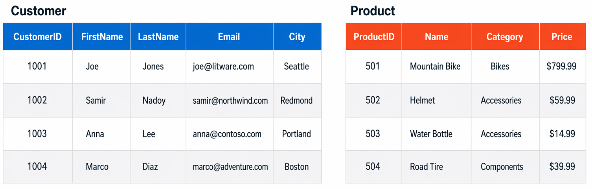</p>

**Semi structured example (JSON).** Both customers have an address and contacts, but the fields are not the same:

```json
// Customer 1
{
  "firstName": "Joe",
  "lastName": "Jones",
  "address": { "streetAddress": "1 Main St.", "city": "New York", "state": "NY", "postalCode": "10099" },
  "contact": [
    { "type": "home", "number": "555 123-1234" },
    { "type": "email", "address": "joe@litware.com" }
  ]
}

// Customer 2
{
  "firstName": "Samir",
  "lastName": "Nadoy",
  "address": { "streetAddress": "123 Elm Pl.", "unit": "500", "city": "Seattle", "state": "WA", "postalCode": "98999" },
  "contact": [
    { "type": "email", "address": "samir@northwind.com" }
  ]
}
```

<p align="center">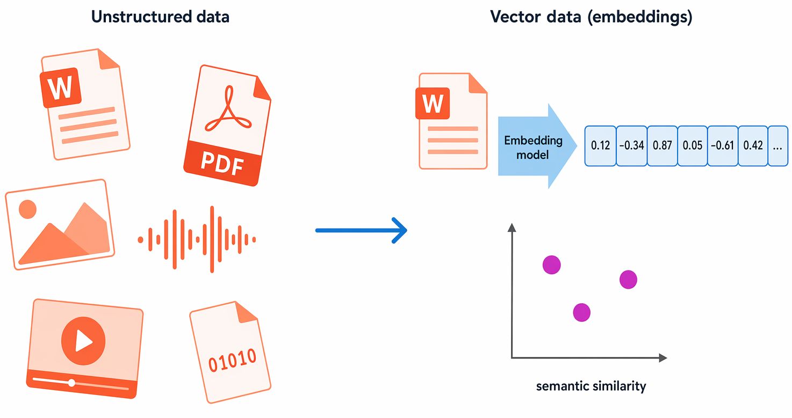</p>

> [!NOTE]
> **Vector data** (also called **embeddings**) is the data type that lets AI assistants answer questions over your own documents and data.

##### Data stores

The two broad categories of data store are **file stores** and **databases**.

#### Explore file storage

The right file format depends on:

- The type of data (structured, semi structured, or unstructured)
- The applications and services that read, write, and process it
- Whether it needs to be human readable or optimized for storage and processing

##### Common file formats

| Format | Description | Best for |
|:--|:--|:--|
| **Delimited text** (CSV, TSV, fixed width) | Plain text with field delimiters and row terminators. The first line can hold field names. | Structured data that many applications must read in a human readable form |
| **JSON** | Hierarchical document schema. Objects use `{ }`, collections use `[ ]`, attributes are `name: value` pairs. | Structured and semi structured data |
| **XML** | Uses tags in angle brackets to define elements and attributes. Largely replaced by JSON. | Older systems |
| **BLOB** (Binary Large Object) | Raw binary data that applications must interpret and render. | Images, video, audio, application specific documents |

**CSV example:**

```text
FirstName,LastName,Email
Joe,Jones,joe@litware.com
Samir,Nadoy,samir@northwind.com
```

**JSON example:**

```json
{
  "customers": [
    {
      "firstName": "Joe",
      "lastName": "Jones",
      "contact": [
        { "type": "home", "number": "555 123-1234" },
        { "type": "email", "address": "joe@litware.com" }
      ]
    },
    {
      "firstName": "Samir",
      "lastName": "Nadoy",
      "contact": [
        { "type": "email", "address": "samir@northwind.com" }
      ]
    }
  ]
}
```

**XML example:**

```xml
<Customers>
  <Customer name="Joe" lastName="Jones">
    <ContactDetails>
      <Contact type="home" number="555 123-1234"/>
      <Contact type="email" address="joe@litware.com"/>
    </ContactDetails>
  </Customer>
  <Customer name="Samir" lastName="Nadoy">
    <ContactDetails>
      <Contact type="email" address="samir@northwind.com"/>
    </ContactDetails>
  </Customer>
</Customers>
```

##### Optimized file formats

These formats support compression, indexing, and efficient storage and processing.

| Format | Storage type | Key points |
|:--|:--|:--|
| **Parquet** | Columnar | The standard format for modern data lakehouses (Apache project). Data is split into **row groups**, and each column's data is stored together. Metadata lets applications jump straight to the right chunk. Handles nested data and compresses well. |
| **Avro** | Row based | Apache project. Each file has a **JSON header** that describes the structure, and the data is stored as binary blocks. Good for compression and for reducing storage and network bandwidth. |
| **Delta Lake** | Built on Parquet | Adds a **transaction log** on top of Parquet, which enables ACID transactions, data versioning, and reliable updates in a data lake. |

<p align="center">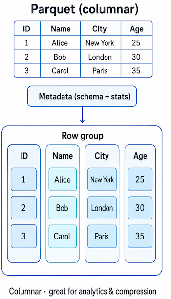</p>

<p align="center">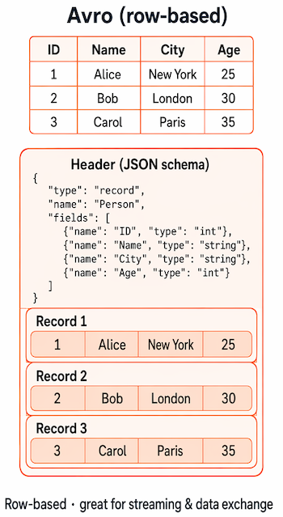</p>

<p align="center">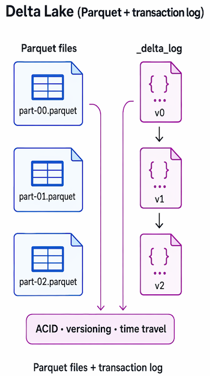</p>

#### Explore databases

A **database** is a dedicated system for storing and querying data records.

##### Relational databases

- Store **structured data** in tables that represent entities.
- Each row has a **primary key** that uniquely identifies it. Other tables reference it with a **foreign key**.
- Keys allow the database to be **normalized**, so duplicate values are removed (for example, customer details are stored once, not on every order).
- Managed and queried with **SQL**, an ANSI standard language that is similar across database systems.

<p align="center">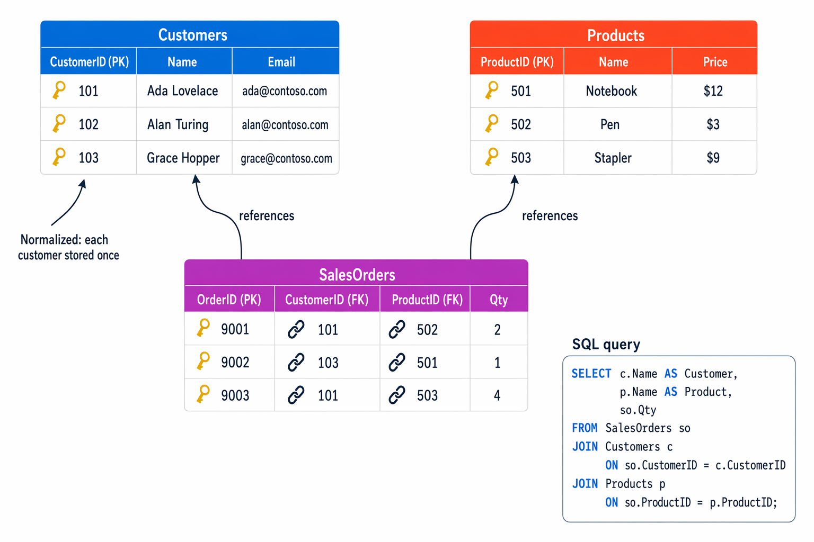</p>

##### Non relational databases

Also called **NoSQL** databases. They do not apply a relational schema to the data.

| Type | How it stores data |
|:--|:--|
| **Key value** | Each record is a unique key plus a value in any format. |
| **Document** | A key value store where the value is a JSON document that the system can parse and query. |
| **Column family** | Rows and columns, with columns divided into groups of related columns called **column families**. |
| **Graph** | Entities are **nodes**, and links between them define relationships. |

<p align="center">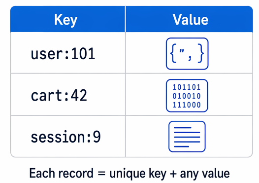</p>

<p align="center">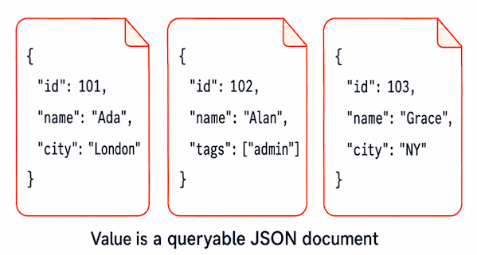</p>

<p align="center">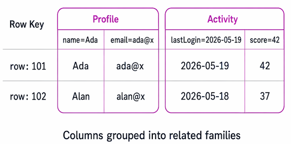</p>

<p align="center">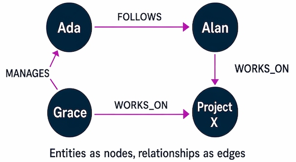</p>

#### Explore transactional data processing

- A transactional system records **transactions**: small, discrete units of work such as a bank transfer or a retail payment.
- This work is called **OLTP** (Online Transactional Processing).
- OLTP systems are high volume, often millions of transactions per day, and are optimized for both reads and writes.
- They support **CRUD** operations: Create, Retrieve, Update, Delete.
- They power live business applications called **line of business (LOB)** applications.

<p align="center">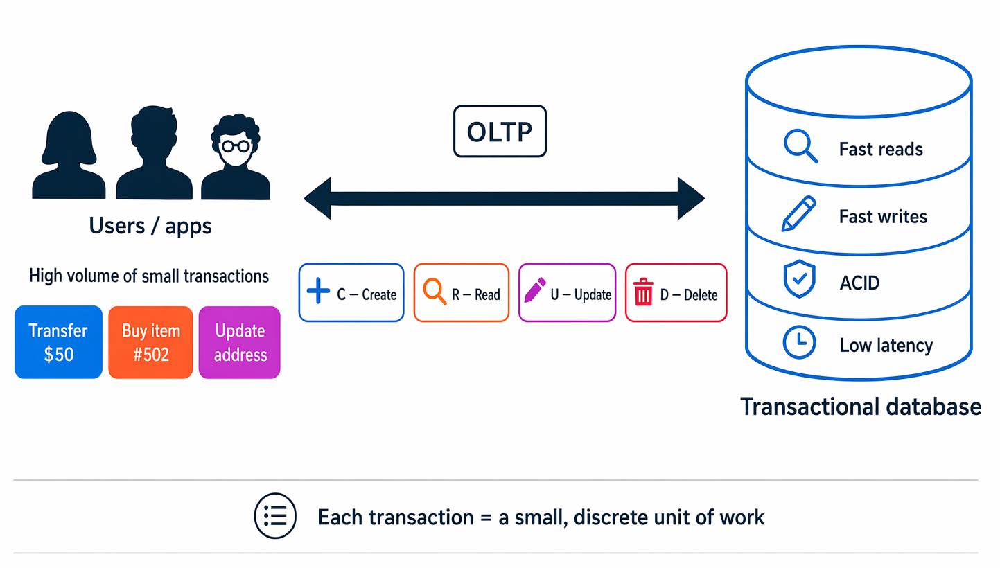</p>

**Example:** Transfer $100 from Account A (balance $300) to Account B (balance $50). The system must debit A and credit B as one reliable operation, ending with A at $200 and B at $150.

<p align="center">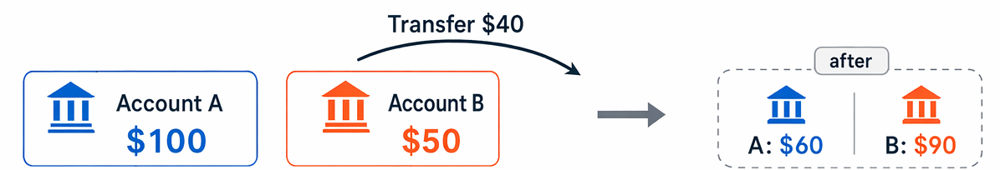</p>

##### ACID properties

| Property | Meaning | In the bank transfer example |
|:--|:--|:--|
| **Atomicity** | Each transaction is one unit that succeeds completely or fails completely. | If the credit to B fails, the debit from A is cancelled too. |
| **Consistency** | A transaction moves the data from one valid state to another valid state. | The final balances must reflect the full $100 transfer. |
| **Isolation** | Concurrent transactions cannot interfere with each other. | A balance check during the transfer cannot see A after the debit and B before the credit. |
| **Durability** | Once committed, a transaction stays committed. | The new balances survive even if the system is switched off. |

<p align="center">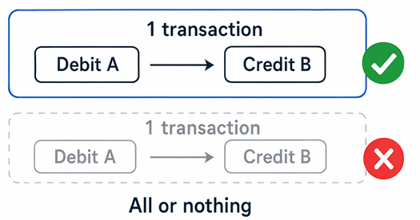</p>

<p align="center">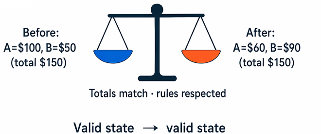</p>

<p align="center">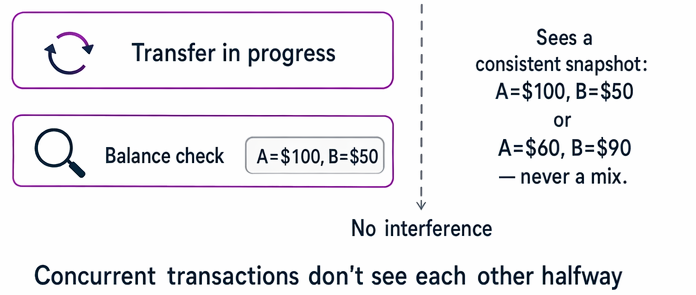</p>

<p align="center">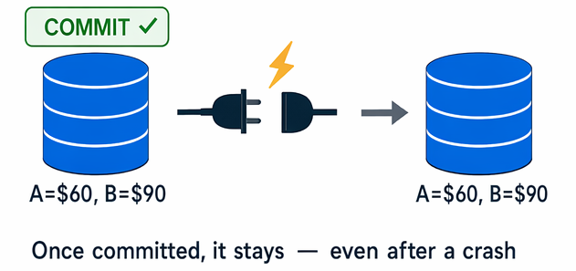</p>

#### Explore analytical data processing

Analytical systems are **read only (or read mostly)** and store large volumes of historical data or business metrics. Analysis can be based on a snapshot of the data or a series of snapshots.

<p align="center">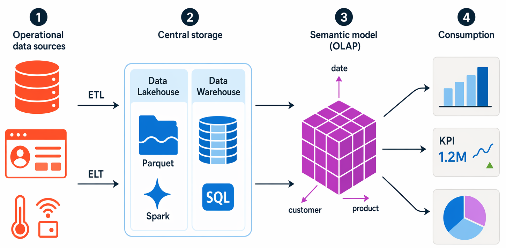</p>

**Common enterprise analytics flow:**

1. Operational data is moved into a data lake using **ETL** (extract, transform, load) or **ELT** (extract, load, then transform; common in modern lakehouses).
2. Data is loaded into tables in a **data lakehouse** or a **data warehouse**.
3. Data may be aggregated into an **OLAP model**, now usually called a **semantic model** (historically a **cube**). **Measures** from fact tables are calculated across **dimensions** (for example, revenue by date, customer, and product). Power BI semantic models are the most common example.
4. The lake, warehouse, and model are queried to build reports, visualizations, and dashboards.

| Store | Description |
|:--|:--|
| **Data lake** | Large volumes of file based data for large scale analytics. |
| **Data warehouse** | Relational schema optimized for read operations, mainly reporting queries. |
| **Data lakehouse** | Combines the flexible, scalable storage of a data lake with the SQL querying of a data warehouse. |
| **OLAP / semantic model** | Preaggregated data across dimensions, so you can **drill up or down** (for example, sales by region, city, or address) quickly. |

> [!NOTE]
> Analytical schemas are often **denormalized** (some duplication is added) so queries run faster.

**Who works where:**

- **Data scientists** work directly with files in the data lake.
- **Data analysts** query tables in the data warehouse.
- **Business users** consume preaggregated data through reports and dashboards.

##### Modern analytics platforms

| Platform | Description |
|:--|:--|
| **Microsoft Fabric** | Unified SaaS analytics platform with storage, data engineering, warehousing, and reporting in one workspace. |
| **Azure Databricks** | Cloud analytics platform for large scale data engineering and data science. Uses **Delta Lake** as its standard storage format. |
| **Microsoft Purview** | Unified data security, governance, and compliance across all data sources. |

<p align="center">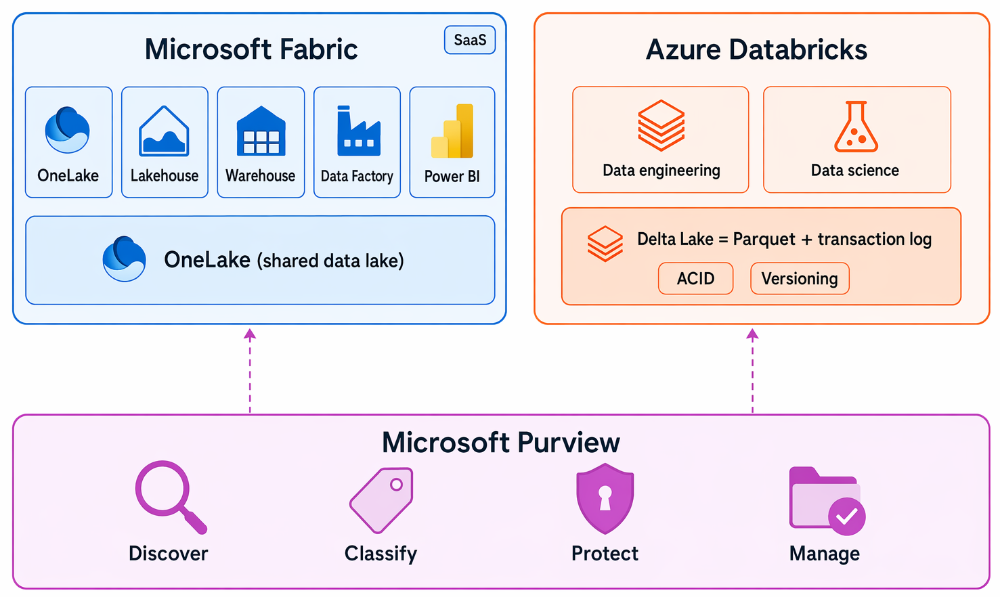</p>

> [!TIP]
> Both Fabric and Databricks include **Copilot** experiences for exploring data with natural language.

##### Medallion architecture

A common pattern for organizing data in a lakehouse:

| Layer | Contents |
|:--|:--|
| 🥉 **Bronze** | Raw data ingested as is, with no transformations. Kept so data can be reprocessed. |
| 🥈 **Silver** | Cleansed and conformed data. Duplicates removed, data types standardized. |
| 🥇 **Gold** | Aggregated, business ready data modeled for reporting and analytics. |

<p align="center">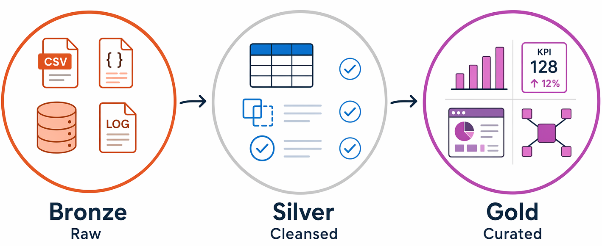</p>

Each layer creates a clear quality boundary, and you can always reprocess from Bronze if requirements change.

#### Key Takeaways

- Data can be **structured**, **semi structured**, or **unstructured**.
- Data is stored in **files** (CSV, JSON, XML, BLOB, Parquet, Avro, Delta Lake) or **databases** (relational or non relational).
- **OLTP** systems handle live transactions and enforce **ACID** properties.
- **Analytical** systems use data lakes, warehouses, lakehouses, and semantic models for reporting.
- The **medallion architecture** organizes lakehouse data into Bronze, Silver, and Gold layers.

<p align="right"><a href="#table-of-contents">⬆ Back to top</a></p>

---

### Module 2: Explore data roles and services

#### Explore job roles in the world of data

| Role | Main responsibilities |
|:--|:--|
| **Database Administrator** | Designs, implements, and maintains on premises and cloud databases. Handles availability, performance, backup and recovery, and security (granting or denying user access). |
| **Data Engineer** | Builds data ingestion pipelines, cleansing and transformation steps, and analytical data stores. Ensures data privacy and monitors pipelines. |
| **Data Analyst** | Explores data to find trends and relationships, builds analytical models, and creates reports and visualizations that turn raw data into insights. |
| **AI Engineer** | Builds and integrates AI features using large language models (LLMs), machine learning pipelines, and data sources. Works with data engineers and analysts. Uses **Microsoft Foundry**. |

<p align="center">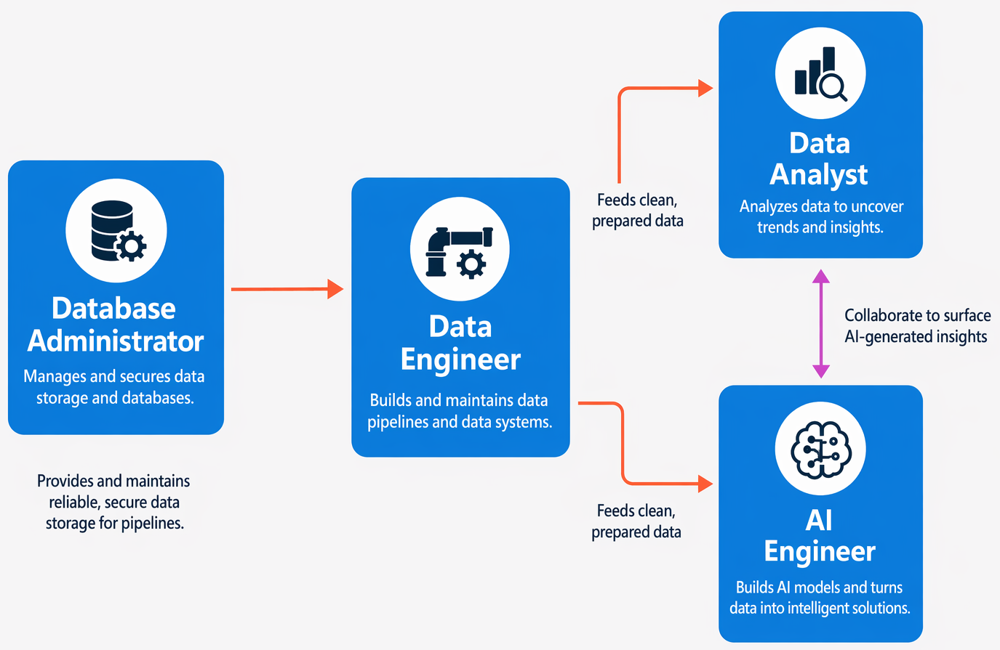</p>

> [!NOTE]
> Roles describe tasks, not people. One person can perform several roles. Other data roles include **data scientist**, **data architect**, application developer, and software engineer.

> [!TIP]
> AI tools now assist every role (troubleshooting, drafting queries, generating code), but judgment, design, and responsible use remain human responsibilities.

#### Identify data services

> [!TIP]
> **PaaS** (platform as a service): Microsoft manages the infrastructure (servers, patching, backups) and you focus on your data.
> **SaaS** (software as a service): the whole product is delivered ready to use, with no infrastructure to manage.

##### Databases

| Service | Description | Used by |
|:--|:--|:--|
|  **Azure SQL** | Family of relational databases based on SQL Server: **Azure SQL Database** (fully managed PaaS), **Azure SQL Managed Instance** (hosted SQL Server instance, more configurable), **Azure SQL VM** (SQL Server on a virtual machine, full control and full responsibility). | DBAs manage it for LOB apps. Engineers use it as a pipeline source. Analysts may query it directly. |
|  **Azure Database for MySQL / PostgreSQL** | Managed open source relational databases. **MySQL** is common in LAMP stack apps (Linux, Apache, MySQL, PHP). **PostgreSQL** is a hybrid relational object database that supports custom data types. | Same as Azure SQL |
|  **Azure Cosmos DB** | Global scale **NoSQL** database with multiple APIs for documents, key value pairs, column families, and graphs. | Developers and DBAs. Engineers integrate it into analytics. |

##### Storage and integration

| Service | Description | Used by |
|:--|:--|:--|
|  **Azure Storage** | Stores data in **Blob containers** (binary files), **File shares** (network shares), and **Tables** (key value storage). Blob storage with a hierarchical namespace hosts **data lakes**. | Data engineers |
|  **Azure Data Factory** | Defines and schedules pipelines to move and transform data (ETL). A version called **Fabric Data Factory** is built into Microsoft Fabric. | Data engineers |

##### Analytics platforms

| Service | Description | Used by |
|:--|:--|:--|
|  **Microsoft Fabric** | Unified SaaS analytics platform built on one storage layer, **OneLake**. Includes Data Factory, Lakehouse, Warehouse, data science, Real Time Intelligence, Power BI, databases, and governance. | All data roles |
|  **Microsoft Fabric IQ** | A Fabric workload that gives data consistent business meaning (shared definitions of Customer, Order, Product) so users and AI agents can ask questions in natural language. | Business users, AI agents |
|  **Azure Databricks** | Analytics platform built on **Apache Spark**, using **Delta Lake**. Code first, notebook based workflows. | Data engineers and analysts |
|  **Power BI** | Business intelligence and visualization platform for interactive reports and dashboards. Standalone or inside Fabric, where it uses **semantic models**. | Data analysts |

##### Real time and log analytics

| Service | Description | Used by |
|:--|:--|:--|
|  **Azure Stream Analytics** | Real time stream processing: takes an input stream, applies a query, and writes results to an output. | Data engineers |
|  **Azure Data Explorer** | High performance querying of log and telemetry data that includes timestamps (for example, IoT data). | Data analysts |

##### Governance and AI

| Service | Description | Used by |
|:--|:--|:--|
|  **Microsoft Purview** | Enterprise data governance and discoverability. Maps data and tracks **data lineage** across sources. | Data engineers |
|  **Microsoft Foundry** | Azure PaaS platform for building, testing, and deploying AI solutions such as chat over your data and multi agent workflows. | AI engineers, developers |

#### Key Takeaways

- The four key data roles are **Database Administrator**, **Data Engineer**, **Data Analyst**, and **AI Engineer**.
- **Azure SQL**, **MySQL**, **PostgreSQL**, and **Cosmos DB** cover transactional databases.
- **Azure Storage** and **Data Factory** handle storage and data movement.
- **Microsoft Fabric**, **Azure Databricks**, and **Power BI** cover analytics and reporting.
- **Purview** handles governance, and **Foundry** is the platform for AI solutions.

<p align="right"><a href="#table-of-contents">⬆ Back to top</a></p>

---

## Part 2: Relational data in Azure

### Module 3: Explore fundamental relational data concepts

#### Understand relational data

- Real world entities are modeled as **tables**. Each **row** is one instance of an entity.
- Every row has the same columns, but some values can be empty (**NULL**), such as a missing middle name.
- Each column has a **data type** (text, decimal, integer, date and time). Standard ANSI data types are supported by most systems.

<p align="center">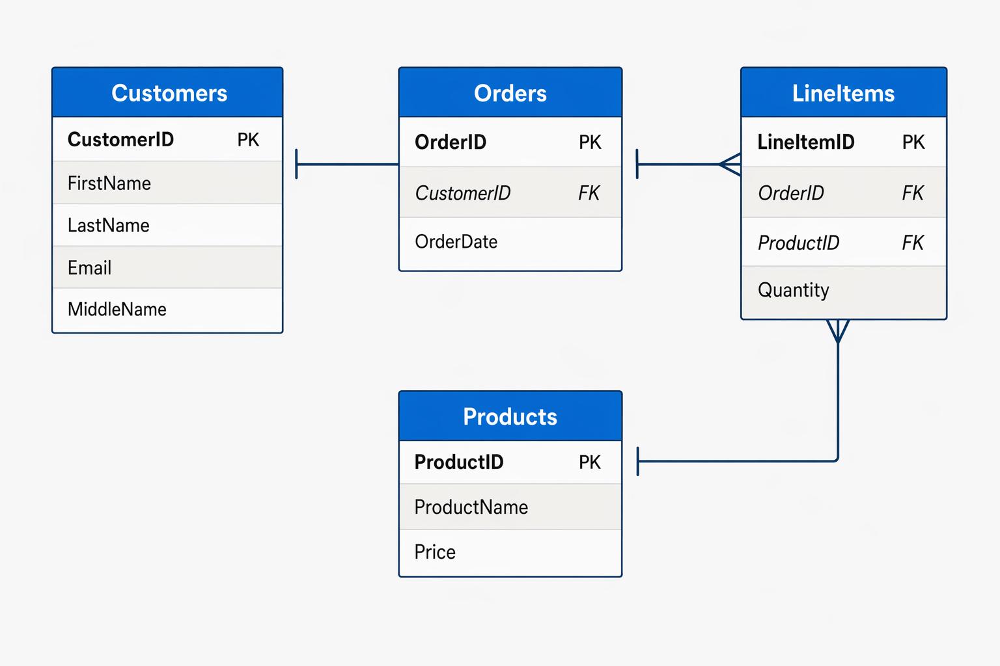</p>

#### Understand normalization

**Normalization** is a schema design process that minimizes duplicate data and enforces data integrity.

**Practical rules:**

1. Separate each **entity** into its own table.
2. Separate each discrete **attribute** into its own column.
3. Uniquely identify each row with a **primary key**.
4. Link related entities with **foreign key** columns.

**Before normalization** (a sales spreadsheet):

| OrderNo | CustomerName | CustomerAddress | ProductName | UnitPrice | Qty |
|:--|:--|:--|:--|:--|:--|
| 1 | Jane Smith | 42 Oak St. Seattle | Widget A | 9.99 | 2 |
| 1 | Jane Smith | 42 Oak St. Seattle | Widget B | 4.49 | 1 |
| 2 | Bob Jones | 18 Pine Ave Portland | Widget A | 9.99 | 5 |
| 2 | Bob Jones | 18 Pine Ave Portland | Gadget X | 24.99 | 1 |
| 3 | Jane Smith | 42 Oak St. Seattle | Gadget X | 24.99 | 3 |
| 3 | Jane Smith | 42 Oak St. Seattle | Widget B | 4.49 | 2 |

Problems: customer and product details repeat on every row, and name and address are combined in one cell.

**After normalization:**

<p align="center">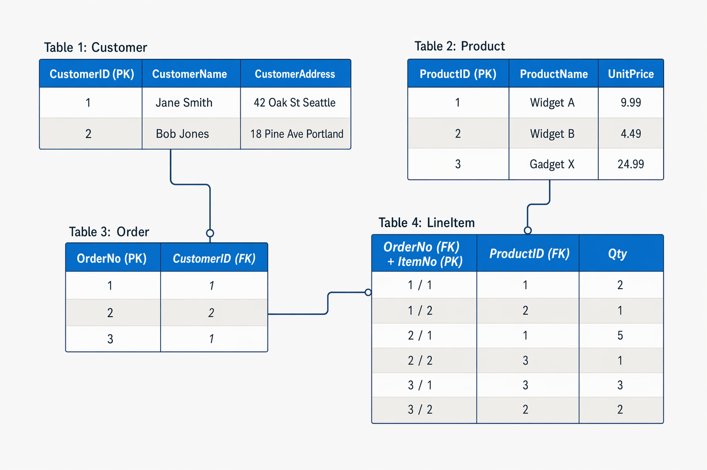</p>

**Benefits:**

- **No duplication.** To change an address, you update one row.
- **Correct data types.** Prices are decimals and quantities are integers.
- **Better querying.** You can filter by a single column, such as city.
- **Referential integrity.** The database can block a foreign key value with no matching primary key (for example, an order for a customer that does not exist).

> [!NOTE]
> A **composite key** uses a unique combination of several columns, such as `OrderNo` plus `ItemNo` in the LineItem table.

#### Explore SQL

**SQL** (Structured Query Language) is the standard language for relational databases. It was standardized by ANSI in 1986 and ISO in 1987. Vendors add their own extensions, which creates different **dialects**:

| Dialect | Used by |
|:--|:--|
| **Transact SQL (T SQL)** | SQL Server, Azure SQL Database, Azure SQL Managed Instance, SQL Server on Azure VMs |
| **pgSQL** | PostgreSQL |
| **PL/SQL** | Oracle (Procedural Language/SQL) |

##### SQL statement types

| Group | Purpose | Statements |
|:--|:--|:--|
| **DDL** (Data Definition Language) | Create, modify, and remove database objects | `CREATE`, `ALTER`, `DROP`, `RENAME` |
| **DCL** (Data Control Language) | Manage permissions | `GRANT`, `DENY`, `REVOKE` |
| **DML** (Data Manipulation Language) | Work with the rows in tables | `SELECT`, `INSERT`, `UPDATE`, `DELETE` |

##### DDL statements

| Statement | Description |
|:--|:--|
| `CREATE` | Create a new object, such as a table or view |
| `ALTER` | Modify an object's structure, such as adding a column |
| `DROP` | Remove an object from the database |
| `RENAME` | Rename an existing object |

```sql
CREATE TABLE Product
(
    ID INT PRIMARY KEY,
    Name VARCHAR(20) NOT NULL,
    Price DECIMAL NULL
);
```

- `PRIMARY KEY` uniquely identifies each row. Every table should have one, although SQL does not enforce it.
- `NOT NULL` marks a **mandatory** column. Without it, a column can hold **NULL** (empty) values.
- Common data types: `INT` (whole number), `DECIMAL` (decimal number), `VARCHAR` (variable length text).

> [!WARNING]
> `DROP` deletes the table and every row in it. Without a backup, the data cannot be recovered.

##### DCL statements

| Statement | Description |
|:--|:--|
| `GRANT` | Give permission to perform specific actions |
| `DENY` | Deny permission to perform specific actions |
| `REVOKE` | Remove a previously granted permission |

```sql
GRANT SELECT, INSERT, UPDATE
ON Product
TO user1;
```

##### DML statements

| Statement | Description |
|:--|:--|
| `SELECT` | Read rows from a table |
| `INSERT` | Insert new rows into a table |
| `UPDATE` | Modify data in existing rows |
| `DELETE` | Delete existing rows |

`SELECT`, `UPDATE`, and `DELETE` apply to **every row** unless you add a `WHERE` clause.

```sql
-- Select all columns for customers in Seattle
SELECT *
FROM Customer
WHERE City = 'Seattle';

-- Select specific columns and sort the results
SELECT FirstName, LastName, Address, City
FROM Customer
WHERE City = 'Seattle'
ORDER BY LastName;

-- Join two tables using table aliases
SELECT o.OrderNo, o.OrderDate, c.Address, c.City
FROM Order AS o
JOIN Customer AS c
ON o.Customer = c.ID;

-- Update one row
UPDATE Customer
SET Address = '123 High St.'
WHERE ID = 1;

-- Delete one row
DELETE FROM Product
WHERE ID = 162;

-- Insert one row
INSERT INTO Product(ID, Name, Price)
VALUES (99, 'Drill', 4.99);
```

> [!WARNING]
> SQL has no "are you sure?" prompt. `UPDATE` or `DELETE` without a `WHERE` clause changes or removes **every** row in the table.

#### Describe database objects

| Object | What it is | Why use it |
|:--|:--|:--|
| **View** | A virtual table based on the results of a `SELECT` query | Simplifies access to data from one or more tables |
| **Stored procedure** | Saved SQL statements that run on command, with optional parameters | Encapsulates logic that applications reuse |
| **Index** | A sorted copy of a column's data with pointers to the rows, stored as a tree | Speeds up queries that filter on that column |

##### View

```sql
CREATE VIEW Deliveries
AS
SELECT o.OrderNo, o.OrderDate,
       c.FirstName, c.LastName, c.Address, c.City
FROM Order AS o JOIN Customer AS c
ON o.Customer = c.ID;

-- Query the view like a table
SELECT OrderNo, OrderDate, LastName, Address
FROM Deliveries
WHERE City = 'Seattle';
```

<p align="center">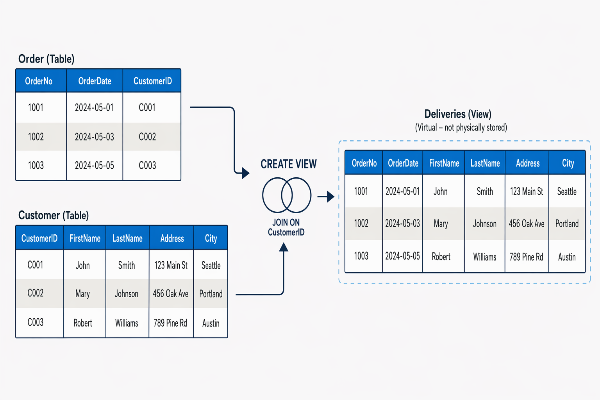</p>

##### Stored procedure

```sql
CREATE PROCEDURE RenameProduct
    @ProductID INT,
    @NewName VARCHAR(20)
AS
UPDATE Product
SET Name = @NewName
WHERE ID = @ProductID;

-- Run it
EXEC RenameProduct 201, 'Spanner';
```

##### Index

Works like the index at the back of a book.

```sql
CREATE INDEX idx_ProductName
ON Product(Name);
```

<p align="center">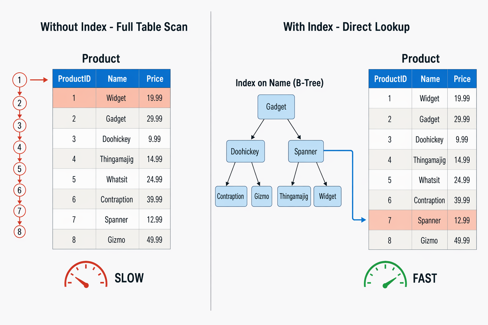</p>

> [!NOTE]
> Indexes are not free. They use storage and must be updated on every insert, update, and delete, which slows those operations. On small tables, the query optimizer may ignore the index. Balance faster queries against slower writes.

#### Key Takeaways

- Relational databases store data in **tables** linked by **primary** and **foreign keys**.
- **Normalization** removes duplication and enforces data integrity.
- SQL statements fall into three groups: **DDL** (define objects), **DCL** (control access), and **DML** (manipulate rows).
- **Views**, **stored procedures**, and **indexes** extend what a database can do.

<p align="right"><a href="#table-of-contents">⬆ Back to top</a></p>

---

### Module 4: Explore relational database services in Azure

Most Azure database services are fully managed, with built in high availability, scaling, threat detection, monitoring, and automatic performance tuning.

#### Describe Azure SQL services and capabilities

##### Compare Azure SQL services

| | <br>**SQL Server on Azure VMs** | <br>**Azure SQL Managed Instance** | <br>**Azure SQL Database** |
|:--|:--|:--|:--|
| **Cloud service type** | IaaS | PaaS | PaaS |
| **SQL Server compatibility** | Fully compatible. Lift and shift without changes. | Near 100% compatible. Minimal code changes. | Most core database features. Some on premises features may be missing. |
| **Architecture** | SQL Server instances on a VM. Each instance supports multiple databases. | Each instance supports multiple databases. **Instance pools** share resources across small instances. | **Single database** on a logical server, or an **elastic pool** that shares resources across databases. |
| **Availability** | 99.99% | 99.99% | 99.995% |
| **Management** | You manage everything: OS, SQL Server updates, configuration, backups. | Automated updates, backups, and recovery. | Automated updates, backups, and recovery. |
| **Use when** | You need full control over server and database configuration. | Most cloud migrations, especially with minimal app changes. | New cloud solutions, or apps with few instance level dependencies. |

##### SQL Server on Azure Virtual Machines

- Full SQL Server running on an Azure VM. This is the **IaaS** approach.
- Works like moving databases from one on premises server to another.
- Best for **lift and shift** migrations, apps that need OS level features, and **hybrid deployments** (part on premises, part in the cloud).
- You have full administrative rights over the DBMS and the OS.

**Use it to:**

- Build development and test environments without buying hardware.
- Migrate existing apps quickly with minimal or no changes.
- Scale the VM up (memory, CPU, disk) without reinstalling software.

> [!NOTE]
> A VM does not remove the need to administer the DBMS as carefully as you would on premises.

##### Azure SQL Managed Instance

- A fully controllable SQL Server instance in the cloud that hosts multiple databases.
- Automates backups, patching, monitoring, replication, high availability, and instance resizing.
- You keep full control over **security** and **resource allocation**.
- All communication is encrypted and signed with certificates.
- Near 100% compatible with SQL Server **Enterprise Edition**.
- Supports **SQL Server logins** (username and password) and **Microsoft Entra ID logins** (uses your computer sign in).

> [!TIP]
> Use the **Data Migration Assistant (DMA)** to check whether an on premises database has issues that would block migration.

##### Azure SQL Database

A PaaS service. You create a managed (logical) database server and deploy databases on it.

> [!NOTE]
> A **SQL Database server** is a logical construct that acts as a central admin point for databases, logins, firewall rules, auditing rules, threat detection policies, and failover groups.

| Option | Description |
|:--|:--|
| **Single Database** | One database on a Microsoft managed server. Resources are preallocated and billed per hour, or you can use a **serverless** configuration that scales automatically. |
| **Elastic Pool** | Multiple databases share a **pool** of resources (memory, storage, CPU). Good for databases whose load varies over time, such as payroll at month end and reports mid month. |
| **Hyperscale** | Service tier for very large databases (up to 100 TB) with rapid scaling and fast backup and restore. |

**Common uses:** modern cloud applications, applications that need high availability, and systems with variable load.

**Business benefits:**

- Automatic updates and patching
- Scaling without costly manual upgrades
- **99.995%** availability, **point in time restore**, and replication across regions
- **Advanced threat protection:** vulnerability assessments and alerts for SQL injection and unusual access
- **Auditing** that writes database events to your Azure storage account
- **Encryption** at rest and in motion
- A free offer for new databases, plus AI assistance for query optimization

#### Describe Azure services for open source databases

These services let organizations move on premises MySQL and PostgreSQL apps to Azure without major changes.

| | MySQL | PostgreSQL |
|:--|:--|:--|
| **What it is** | Simple, open source relational DBMS. Leading database for **LAMP** stack apps. | **Hybrid relational object** database that supports custom data types and geometric data (lines, circles, polygons). Extensible with code modules. |
| **Editions / language** | Community (free), Standard, Enterprise | Uses **pgsql**, a SQL variant for stored procedures |

##### Azure Database for MySQL

- PaaS version of MySQL, based on the **Community Edition**.
- Built in high availability at no extra cost, and pay as you go pricing.
- Automatic backups with **point in time restore for up to 35 days** (7 days by default).
- Firewall rules and optional SSL connections.
- Monitoring with alerts, metrics, and logs.
- Some security and administration functions are not available because Azure manages them.

##### Azure Database for PostgreSQL

- PaaS version of PostgreSQL with the same availability, performance, scaling, and security benefits as the MySQL service.
- Built in failure detection and failover.
- Works with **pgAdmin**, although server level tasks like backup and restore are managed by Microsoft.
- Query history is saved in the `azure_sys` database. Query the `query_store.qs_view` view to monitor and tune queries.
- Some extensions (for example, stored procedures in languages other than pgsql, or direct OS interaction) are not available.

##### Flexible Server

Both MySQL and PostgreSQL offer a **Flexible Server** deployment option:

- Fully managed, with more control over configuration and cost optimization.
- The recommended option for new workloads.
- Free for 12 months with an Azure free account.

#### Key Takeaways

- **Azure SQL** comes in three options: **SQL Server on Azure VMs** (IaaS, full control), **SQL Managed Instance** (PaaS, near full compatibility), and **SQL Database** (PaaS, built for the cloud).
- SQL Database is available as a **Single Database**, an **Elastic Pool**, or the **Hyperscale** tier.
- **Azure Database for MySQL** and **Azure Database for PostgreSQL** are managed open source options. **Flexible Server** is recommended for new workloads.

<p align="right"><a href="#table-of-contents">⬆ Back to top</a></p>

---

## Part 3: Non relational data in Azure

### Module 5: Explore Azure Storage for non relational data

#### Azure blob storage

**Azure Blob Storage** stores massive amounts of unstructured data as **blobs** (binary large objects).

- Blobs are stored in **containers**, which group related blobs. Access is controlled at the container level.
- **Microsoft Entra ID** with **Azure RBAC** (role based access control) is the recommended way to sign in and assign permissions.
- Folders inside a container are **virtual** by default. They are just `/` characters in blob names, so you cannot set access or run bulk operations at the folder level.

<p align="center">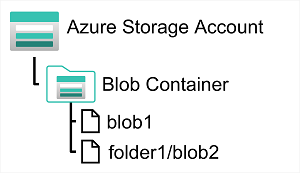</p>

##### Blob types

| Type | Structure | Max size | Best for |
|:--|:--|:--|:--|
| **Block blob** | Set of blocks, each up to 4,000 MiB | About 190.7 TiB | Large, discrete binary objects that change rarely |
| **Page blob** | Fixed 512 byte pages, random read and write | 8 TB | Virtual disks for VMs |
| **Append blob** | Block blob that only allows adding to the end (blocks up to 4 MB) | About 195 GB | Logs and other append only data |

<p align="center">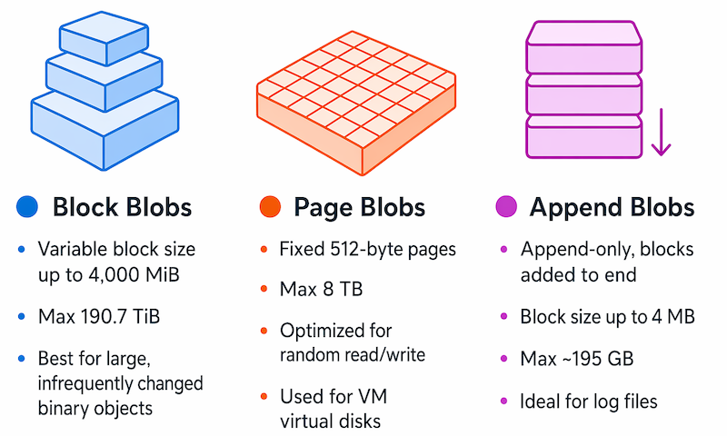</p>

##### Access tiers

| Tier | Storage cost | Access cost | Minimum days | Use for |
|:--|:--|:--|:-:|:--|
| **Hot** (default) | Highest | Lowest | None | Frequently accessed data |
| **Cool** | Lower | Higher | 30 | Infrequently accessed data |
| **Cold** | Lower than Cool | Higher than Cool | 90 | Rarely accessed data that still needs fast retrieval (short term backups, disaster recovery) |
| **Archive** | Lowest | Highest, up to 15 hours latency | 180 | Historical data that must be kept but is rarely needed |

<p align="center">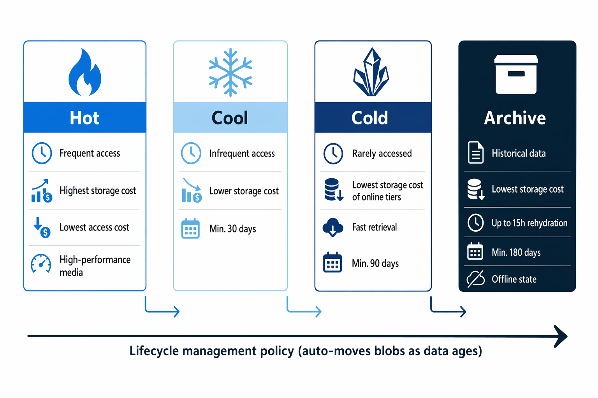</p>

- Removing data before the minimum days triggers an **early deletion penalty**.
- Archive blobs are offline. To read one, change its tier to Hot, Cool, or Cold and wait for **rehydration** to finish.
- **Lifecycle management policies** can move blobs from Hot to Cool to Cold to Archive as they age, and delete outdated blobs.

##### Redundancy options

| Option | How data is copied |
|:--|:--|
| **LRS** (locally redundant) | Three copies in one datacenter |
| **ZRS** (zone redundant) | Copies across three availability zones in the primary region |
| **GRS** (geo redundant) | Replicated to a secondary region hundreds of miles away |
| **GZRS** (geo zone redundant) | Zone redundant in the primary region, plus replication to a secondary region |
| **RA GRS / RA GZRS** | Same as GRS or GZRS, with **read access** to the secondary region before a failover |

<p align="center">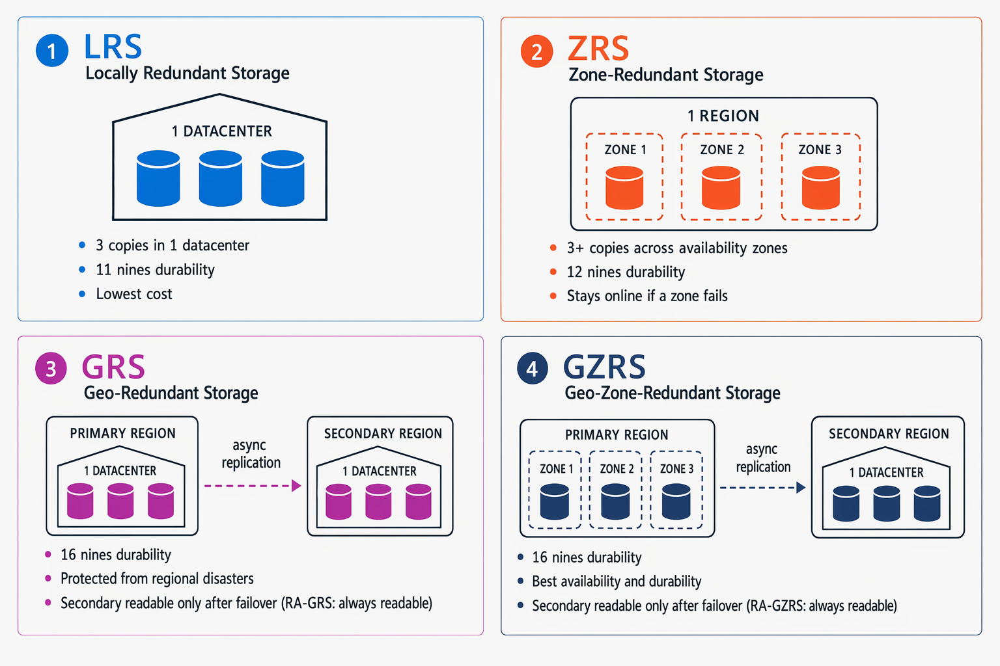</p>

#### Explore Azure Data Lake Storage Gen2

- A cloud scale data lake built into Azure Storage.
- Combines Blob Storage scalability and cost control (tiers, lifecycle management) with a **hierarchical file system** that works with major analytics systems.
- Azure Databricks can mount it. Microsoft Fabric's **OneLake** is built on top of it.
- The hierarchical namespace enables **POSIX compliant ACLs** (access control lists) for read, write, and execute permissions on individual files and folders, separate from Azure RBAC.

<p align="center">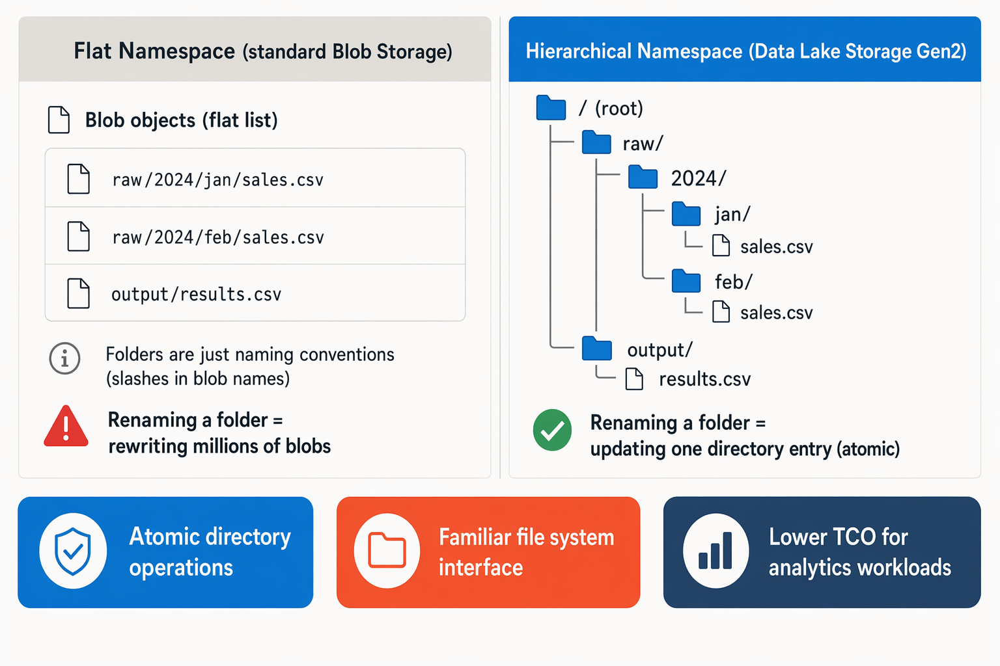</p>

> [!WARNING]
> To create a Data Lake Storage Gen2 file system, enable **Hierarchical Namespace** on the storage account. Upgrading an existing account is **one way**. You cannot go back to a flat namespace.

#### Explore Microsoft OneLake in Fabric

**OneLake** is a single, unified, logical data lake for the whole organization. It is provisioned automatically with every Microsoft Fabric tenant and is built on Azure Data Lake Storage Gen2. It supports any file type and lets multiple analytical engines use the same data without moving or copying it.

<p align="center">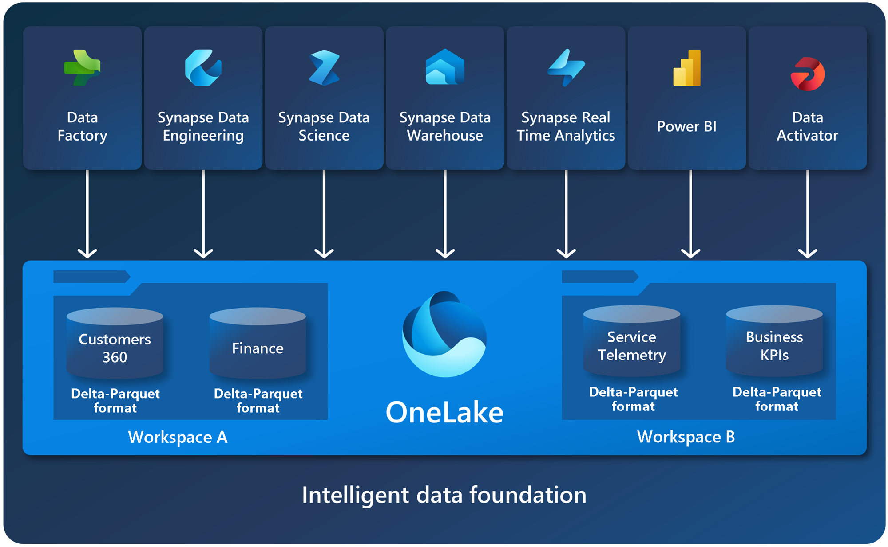</p>

**Key benefits:**

- **Organization wide data lake:** one shared data lake instead of a separate one for each business group.
- **Distributed ownership:** **workspaces** let different teams manage their own data within governance boundaries.
- **Open and compatible:** stores data in **Delta Parquet** format and supports existing ADLS Gen2 APIs and SDKs.
- **Easy to navigate:** browse OneLake from Windows using **OneLake file explorer**.

#### Explore Azure Files

**Azure Files** creates cloud based **network file shares**, removing hardware costs and maintenance.

<p align="center">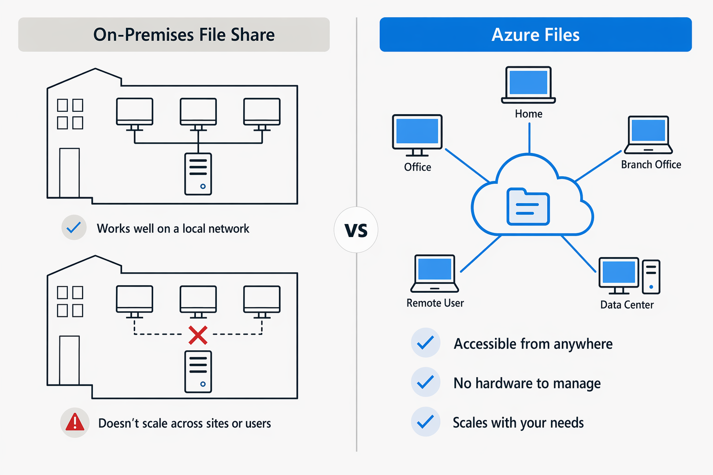</p>

| Feature | Detail |
|:--|:--|
| **Capacity** | Up to 256 TiB per storage account for SSD (more for HDD) |
| **Max file size** | 4 TiB. You can set quotas per share. |
| **Concurrency** | Up to 2,000 concurrent handles per file or directory |
| **Upload tools** | Azure portal, **AzCopy**, and **Azure File Sync** (syncs local cached copies) |
| **Media tiers** | **HDD** (hard disk) or **SSD** (higher throughput, higher cost) |

<p align="center">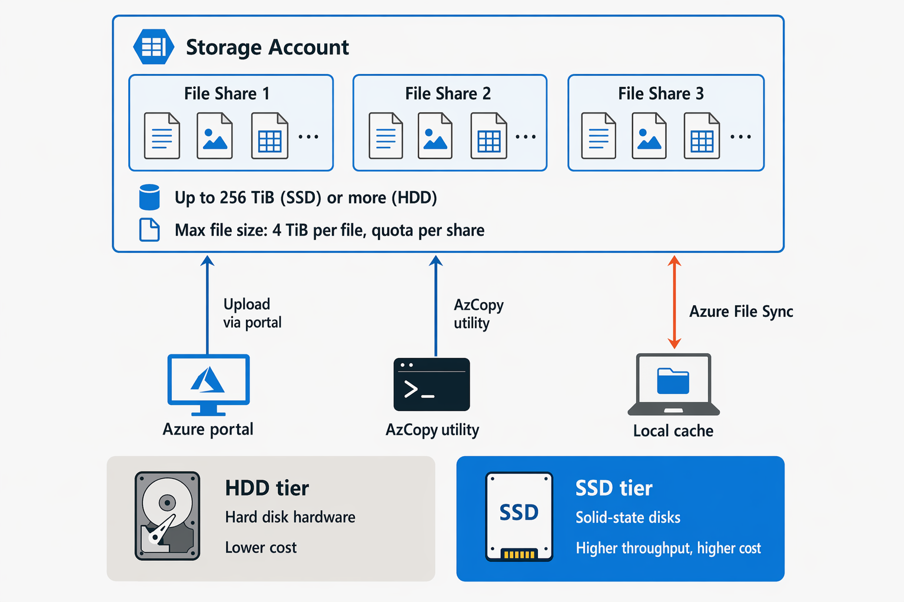</p>

| Protocol | Supported on | Notes |
|:--|:--|:--|
| **SMB** (Server Message Block) | Windows, Linux, macOS | Most common |
| **NFS** (Network File System) | Linux (kernel 4.3 or later) only | Requires an SSD tier account and a virtual network |

#### Explore Azure Tables

**Azure Table Storage** is a **NoSQL** store of **key/value** items. Each item is a row with columns for its data fields.

<p align="center">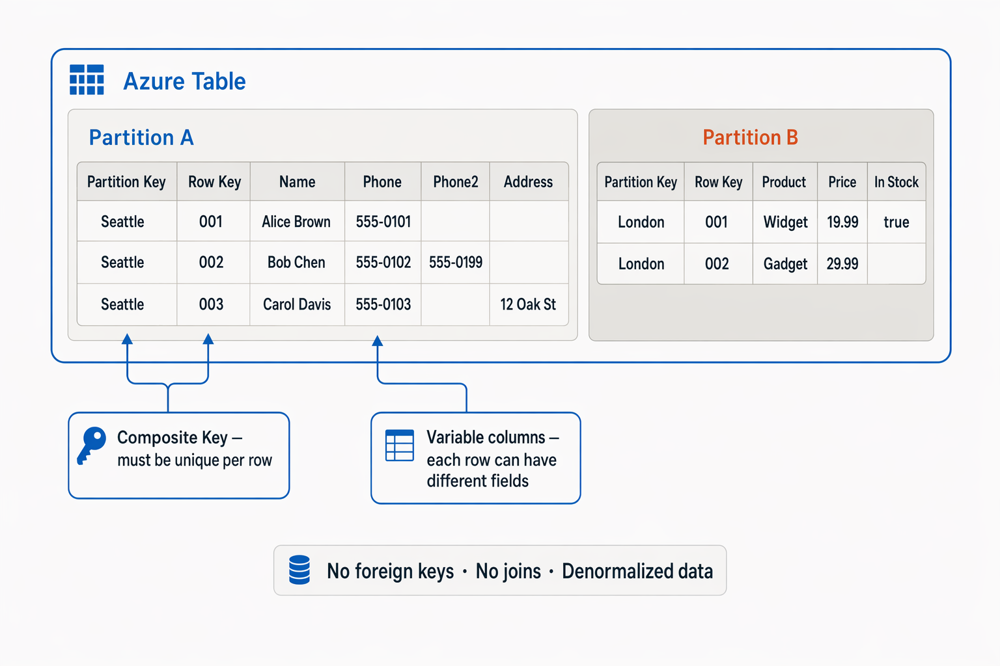</p>

- It is **not** like a relational table. It holds **semi structured** data, and columns can differ between rows.
- There are no foreign keys, relationships, stored procedures, or views.
- Data is usually **denormalized**: each row holds all the data for one entity.
- Each row has a unique key made of a **partition key** and a **row key**, plus a **timestamp** that records the last modification.

**Partitioning** groups related rows by **PartitionKey**:

- Partitions are independent and can grow or shrink. A table can have any number of partitions.
- Including the partition key in a search reduces the I/O needed to find data.
- Rows in a partition are stored in **row key** order, which enables fast **point queries** (one row) and **range queries** (a block of rows).

> [!TIP]
> For new workloads, **Azure Cosmos DB for Table** is recommended. It uses the same key/value model with better performance and global availability.

#### Key Takeaways

- **Blob Storage** holds unstructured data, with three blob types, four access tiers, and several redundancy options.
- **Data Lake Storage Gen2** adds a hierarchical namespace and ACLs on top of Blob Storage.
- **OneLake** is Fabric's organization wide data lake, built on ADLS Gen2.
- **Azure Files** provides cloud file shares over SMB or NFS.
- **Azure Tables** stores semi structured key/value data, organized by partition key and row key.

<p align="right"><a href="#table-of-contents">⬆ Back to top</a></p>

---

### Module 6: Explore fundamentals of Azure Cosmos DB

#### Describe Azure Cosmos DB

**Azure Cosmos DB** is a fully managed **NoSQL** database (PaaS). Microsoft handles provisioning, patching, updates, and backups.

- **Schema agnostic:** items in the same container do not need the same structure.
- Used internally by Xbox Live, Microsoft 365, and core parts of Azure.

##### How Cosmos DB organizes data

| Level | Description |
|:--|:--|
| **Account** | Top level Azure resource. Can hold unlimited databases. |
| **Database** | Logical namespace that groups containers. |
| **Container** | Main unit of storage and scaling. Set the **partition key**, throughput, indexing policy, and optional **TTL** (time to live) here. |
| **Item** | A single data entity. Called a document, row, node, or edge depending on the API. |

<p align="center"></p>

- The **partition key** spreads data across logical partitions. Each logical partition holds up to **20 GB**.
- A good partition key has **many distinct values** and spreads data **evenly**.
- All properties are **indexed automatically** by default.

##### Global distribution and performance

- Add Azure regions at any time and data is replicated automatically. Users read and write to the nearest replica.
- At the 99th percentile, reads take about **4 ms** and writes about **5 ms**.

| Consistency level | Description |
|:--|:--|
| **Strong** | Every read reflects the most recent write. |
| **Bounded staleness** | Reads lag behind writes by a set time or number of versions. |
| **Session** | Consistency is guaranteed within one client session. **Most widely used and the recommended starting point.** |
| **Consistent prefix** | Reads never see writes out of order, but may see stale data. |
| **Eventual** | Replicas converge over time. Weakest guarantee, highest availability. |

<p align="center">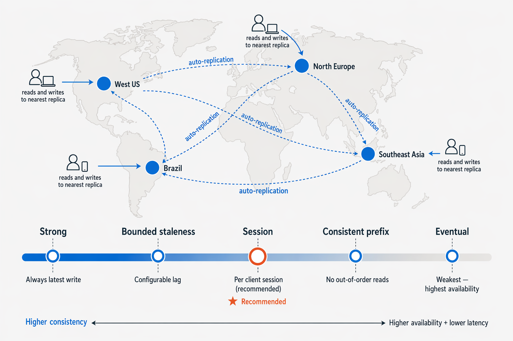</p>

##### Throughput modes and pricing

Capacity is measured in **Request Units per second (RU/s)**. One RU/s is roughly the cost of reading a 1 KB item. Every operation consumes RUs.

| Mode | Description |
|:--|:--|
| **Dedicated** | Throughput reserved for a single container. |
| **Shared** | Throughput set at the database level and shared by up to 25 containers. |
| **Serverless** | Nothing provisioned upfront. Pay per request. Best for low or unpredictable traffic. **Limited to one region.** |

**Autoscale** lets you set a maximum RU/s, and Cosmos DB adjusts capacity within that range based on demand.

<p align="center">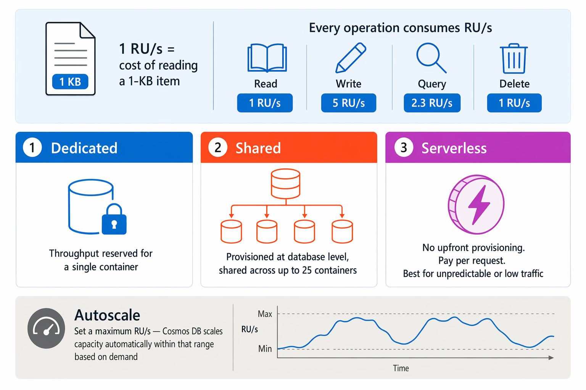</p>

##### When to use Cosmos DB

| ✅ Good fit | ❌ Not a good fit |
|:--|:--|
| **IoT and telemetry:** fast ingestion of device data | Complex multi table joins (use **Azure SQL Database**) |
| **Gaming:** profiles and leaderboards with millisecond response | Large scale historical analytics (use **Microsoft Fabric** or **Azure Synapse Analytics**) |
| **Retail:** product catalogs, carts, order pipelines | |
| **Web and mobile apps:** personalization and social features | |

#### Identify Azure Cosmos DB APIs

You choose an API when you create a Cosmos DB account. The API sets the data format, query language, and client libraries. Internally, Cosmos DB stores data in its own format. The main benefit is **portability**: existing MongoDB or Cassandra apps can move to Cosmos DB with minimal code changes.

<p align="center">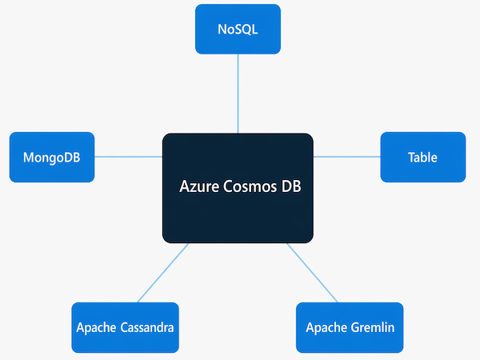</p>

| API | Data model | Query language | Choose it when |
|:--|:--|:--|:--|
| **NoSQL** | JSON documents | SQL like syntax | Building a new application (recommended) |
| **MongoDB** | BSON (binary JSON) | MongoDB Query Language (MQL) | Your team knows MongoDB or is migrating a MongoDB workload |
| **Table** | Key/value tables | REST style requests by PartitionKey and RowKey | Moving from Azure Table Storage |
| **Apache Cassandra** | Column family | CQL (Cassandra Query Language) | Migrating a Cassandra workload |
| **Apache Gremlin** | Graph (vertices and edges) | Gremlin | Relationships matter as much as the data |

##### Cosmos DB for NoSQL

The native API. It was called the **SQL API** until 2023.

```sql
SELECT *
FROM customers c
WHERE c.id = "joe@litware.com"
```

Result:

```json
{
  "id": "joe@litware.com",
  "name": "Joe Jones",
  "address": { "street": "1 Main St.", "city": "Seattle" }
}
```

> [!TIP]
> Cosmos DB for NoSQL supports **Fabric mirroring**, which replicates operational data into Microsoft Fabric automatically with no pipeline, so you can run analytics without affecting transactions.

##### Cosmos DB for MongoDB

Compatible with MongoDB drivers and client libraries.

```javascript
db.products.find({id: 123})
```

Result:

```json
{ "id": 123, "name": "Hammer", "price": 2.99 }
```

##### Cosmos DB for Table

Uses the same programming model as Azure Table Storage, and adds more scalability, global distribution, automatic secondary indexes, and instant autoscale.

| PartitionKey | RowKey | Name | Email |
|:--|:--|:--|:--|
| 1 | 123 | Joe Jones | joe@litware.com |
| 1 | 124 | Samir Nadoy | samir@northwind.com |

```text
https://endpoint/Customers(PartitionKey='1',RowKey='124')
```

##### Cosmos DB for Apache Cassandra

Column family model, so rows do not need the same columns.

| ID | Name | Manager |
|:--|:--|:--|
| 1 | Sue Smith | |
| 2 | Ben Chan | Sue Smith |

```sql
SELECT * FROM Employees WHERE ID = 2
```

##### Cosmos DB for Apache Gremlin

Graph data: entities are **vertices** (nodes) and relationships are **edges**. Useful for social networks, recommendations, fraud detection, and org charts.

<p align="center">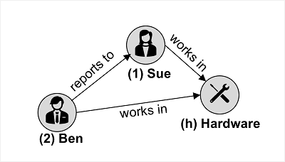</p>

```groovy
// Add an employee vertex and connect it to an existing one
g.addV('employee').property('id', '3').property('firstName', 'Alice')
g.V('3').addE('reports to').to(g.V('1'))

// Get all employees ordered by ID
g.V().hasLabel('employee').order().by('id')
```

#### Key Takeaways

- **Cosmos DB** is a fully managed, schema agnostic, globally distributed NoSQL database.
- Data is organized as **Account, Database, Container, Item**, and spread by a **partition key**.
- There are **five consistency levels**. **Session** is the usual starting point.
- Capacity is measured in **RU/s**, with **dedicated**, **shared**, or **serverless** throughput.
- There are **five APIs**: NoSQL (recommended for new apps), MongoDB, Table, Cassandra, and Gremlin.

<p align="right"><a href="#table-of-contents">⬆ Back to top</a></p>

---

## Part 4: Data analytics in Azure

### Module 7: Explore fundamentals of large scale analytics

#### Large scale analytics

The two main Azure analytics platforms:

| Platform | Description |
|:--|:--|
| **Microsoft Fabric** | Unified SaaS platform for data engineering, warehousing, real time analytics, data science, and Power BI on one storage layer, **OneLake**. No servers or clusters to manage. |
| **Azure Databricks** | Analytics platform built on **Apache Spark**, using **Delta Lake** (Parquet plus transactions, schema enforcement, and versioning). Code first, notebook based. |

Large scale analytics combines:

- **Data warehousing:** copying transactional data into a relational schema **optimized for querying**.
- **Big data processing:** large volumes of data in many formats, **batch loaded** or captured in **real time streams**, stored in a **data lake**, and processed by engines like **Apache Spark**.

Together, these lead to the **data lakehouse** design.

<p align="center">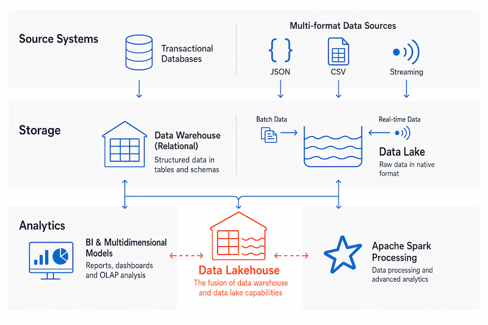</p>

#### Describe data warehousing architecture

<p align="center">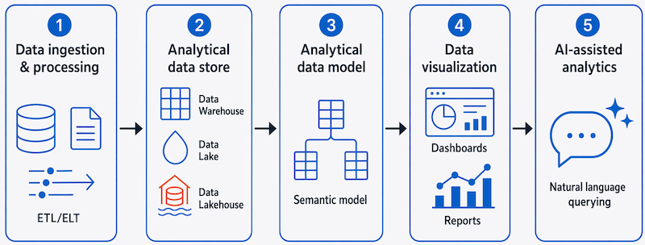</p>

| # | Layer | Description |
|:-:|:--|:--|
| 1 | **Data ingestion and processing** | Data is loaded into a data lake or warehouse with **ETL** (transform before loading) or **ELT** (load, then transform). Often runs on distributed multi node clusters. Covers both batch and real time data. |
| 2 | **Analytical data store** | Relational **data warehouses**, file based **data lakes**, or hybrid **data lakehouses**. |
| 3 | **Analytical data model** | Historically **cubes** (preaggregated, for example in SSAS). Today a **semantic model** with tables, relationships, hierarchies, and **DAX** measures, aggregated at query time. In Fabric, **Direct Lake** mode reads Delta tables in OneLake directly. |
| 4 | **Data visualization** | Reports, dashboards, and self service analysis showing trends, comparisons, and KPIs. |
| 5 | **AI assisted analytics** | Power BI **Q&A** (questions in plain English), **Copilot in Fabric** (generates DAX and SQL, summarizes reports), and **Genie** in Databricks (generates and runs SQL from questions). |

##### The modern analytics stack on Azure

| Microsoft Fabric component | Role |
|:--|:--|
| **Fabric Lakehouse** | Data lake storage with SQL querying. Delta Lake format, exposed through a **SQL analytics endpoint**. |
| **Fabric Warehouse** | Fully managed, SQL Server compatible relational warehouse with strong schema enforcement. |
| **Fabric Data Factory** | Pipelines and low code transformations for ingestion. |
| **Power BI** | Reports, dashboards, and semantic models. **Direct Lake** mode needs no import or scheduled refresh. |

| Azure Databricks component | Role |
|:--|:--|
| **Databricks Lakehouse** | Unified Delta Lake storage for SQL analytics and machine learning. |
| **Databricks SQL** | Serverless SQL warehouse with query history, dashboards, and alerts. |
| **Databricks Notebooks** | Collaborative Python, SQL, Scala, and R notebooks. |
| **Unity Catalog** | Governance for data and AI assets: access control, lineage, and discovery. |
| **Genie** | Conversational AI interface that generates and runs SQL. |

#### Explore data ingestion pipelines

<p align="center">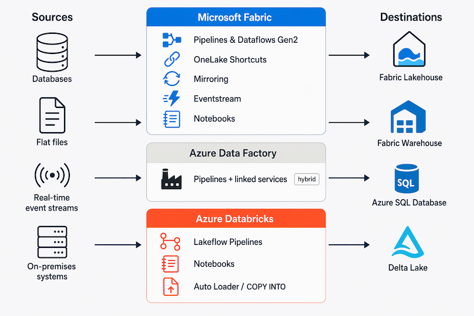</p>

##### Microsoft Fabric ingestion options

| Option | Description |
|:--|:--|
| **Fabric Data Factory** | Recommended starting point. **Pipelines** orchestrate multi step workflows of **activities**, using **linked services** to connect to sources and destinations. **Dataflows Gen2** offer low code transformations with Power Query. |
| **OneLake Shortcuts** | A live reference to external storage (ADLS Gen2, Amazon S3, Google Cloud Storage, other OneLake locations). Data appears in your Lakehouse with no copying. |
| **Mirroring** | Continuously replicates an external database (Azure SQL Database, Snowflake, Cosmos DB) into OneLake in near real time, in Delta Lake format. |
| **Eventstream** | Real time ingestion from Event Hubs, Kafka, IoT Hub, and custom endpoints. Routes, filters, and transforms events into a Lakehouse, **KQL database**, or Real Time Intelligence. |
| **Fabric Notebooks** | Code first Spark option (PySpark, Python, Scala, R, SQL) for custom logic or sources without a built in connector. |

##### Azure Data Factory

The standalone Azure service for pipelines **outside of Fabric**, such as when the destination is Azure SQL Database or when connecting to on premises sources. It uses the same pipeline and linked service model as Fabric Data Factory, so skills transfer.

##### Azure Databricks ingestion options

| Option | Description |
|:--|:--|
| **Lakeflow Spark Declarative Pipelines** | You define what the output tables should contain. Databricks handles ordering, dependencies, and incremental processing. Recommended for production pipelines. |
| **Databricks Notebooks** | For ad hoc or exploratory ingestion from REST APIs, JDBC, cloud storage, or streams into Delta tables. Can be scheduled as jobs. |

#### Explore analytical data stores

| | Data warehouse | Data lake |
|:--|:--|:--|
| **Storage** | Relational database | File store on a distributed file system |
| **Schema** | Applied when data is written | **Schema on read**: applied when data is read |
| **Data types** | Structured | Structured, semi structured, and unstructured |
| **Query with** | SQL | Engines like **Apache Spark** |
| **Best for** | Transactional data organized into tables and queried with SQL | Mixed data analyzed without schema enforcement at write time |

##### Data warehouse schemas

- **Fact tables** hold numeric values (for example, sales orders).
- **Dimension tables** hold the entities you aggregate by (customer, product, store, time).
- **Star schema:** a fact table related to dimension tables.
- **Snowflake schema:** a star schema with extra tables for dimension hierarchies (for example, product related to product category).

<p align="center">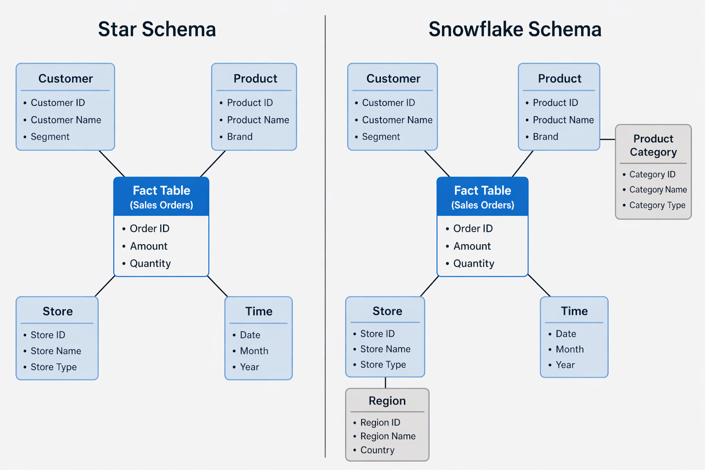</p>

<p align="center">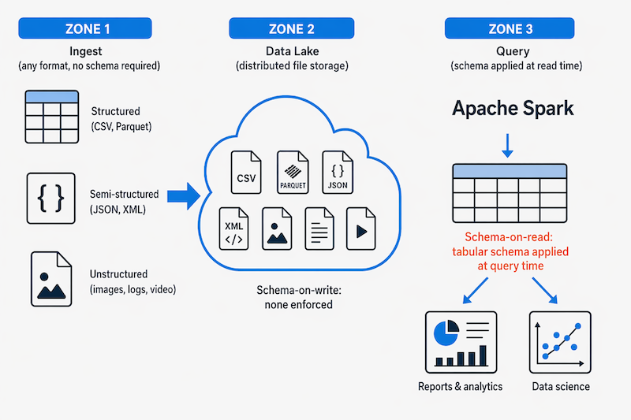</p>

##### Hybrid approaches

A **data lakehouse** stores raw files in a data lake and exposes them as tables through a **SQL analytics endpoint**. It is enabled by **Delta Lake**, which adds schema enforcement, transactional consistency, support for batch and streaming sources, and a SQL API on top of Parquet.

In Fabric, Lakehouse and Warehouse data both live in **OneLake**. A SQL analytics endpoint is created automatically with each Lakehouse.

<p align="center">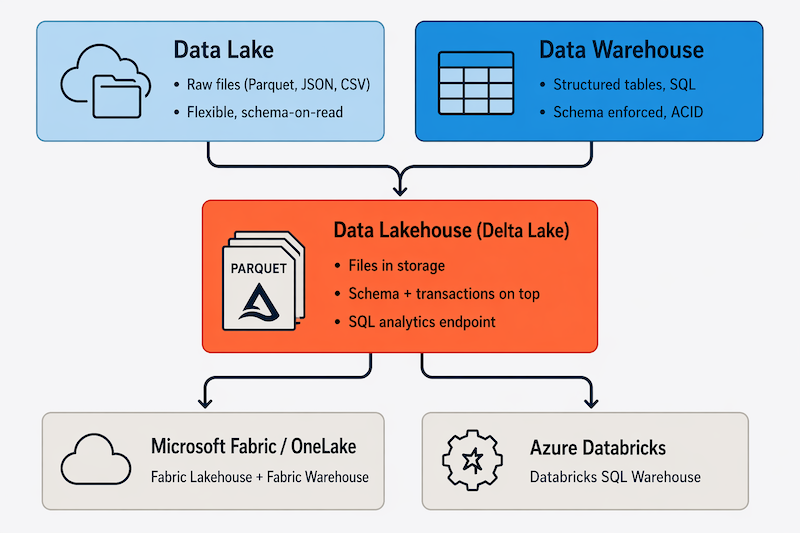</p>

##### Azure services for analytical stores

| Service | Choose it when |
|:--|:--|
| **Fabric Lakehouse** | Working with mixed or semi structured data, or running machine learning |
| **Fabric Warehouse** | Data is structured, the team writes SQL, and you need strong schema enforcement and high concurrency |
| **Azure Databricks** (with **Databricks SQL Warehouse** for BI) | You need code first Spark workflows, multicloud portability, or already have Databricks expertise |

> [!NOTE]
> These services can be combined. For example, ingest data into a data lake, process it with a Databricks notebook, and load the results into a Fabric Warehouse.

#### Key Takeaways

- A large scale analytics solution has layers for **ingestion**, **storage**, **modeling**, **visualization**, and **AI assistance**.
- **Microsoft Fabric** (with OneLake) and **Azure Databricks** (with Delta Lake) are the two main platforms.
- Fabric ingestion options include **Data Factory**, **Shortcuts**, **Mirroring**, **Eventstream**, and **Notebooks**.
- **Data warehouses** use star or snowflake schemas. **Data lakes** use schema on read. **Lakehouses** combine both through Delta Lake.

<p align="right"><a href="#table-of-contents">⬆ Back to top</a></p>

---

### Module 8: Explore fundamentals of real time analytics

#### Understand batch and stream processing

| | Batch processing | Stream processing |
|:--|:--|:--|
| **How it works** | Data is collected and stored, then processed together as a group | Each new piece of data is processed as it arrives |
| **Trigger** | Schedule (for example, hourly), data volume, or an event | Continuous |
| **Data scope** | All data in the dataset | Most recent data, or a rolling time window (for example, the last 30 seconds) |
| **Data size** | Large datasets | Individual records or small **micro batches** |
| **Latency** | Typically a few hours | Seconds or milliseconds |
| **Analysis** | Complex analytics | Simple responses, aggregates, rolling averages |
| **Example** | Monthly credit card bill | Stock market tracking, live game data, location based recommendations, fire alarms |

**Car counting analogy:**

- **Batch:** park the cars in a lot, then count them all at once.
- **Stream:** count the cars as they drive past, for example per minute.

<p align="center">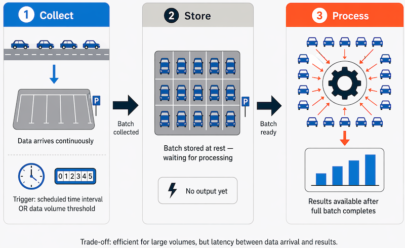</p>

<p align="center">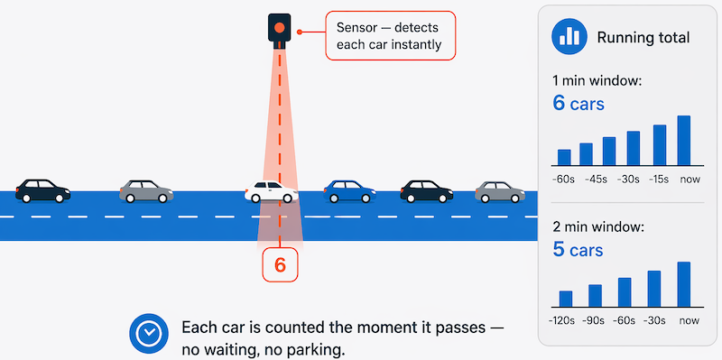</p>

##### Batch processing pros and cons

| ✅ Advantages | ❌ Disadvantages |
|:--|:--|
| Processes large volumes efficiently at a convenient time | All input data must be ready before processing starts |
| Jobs can run during off peak times, such as overnight | Delay between input and results |
| | One error or crash can stop the whole batch |
| | Input data must be checked carefully before rerunning |
| | Even small data errors can make the whole job fail |

##### Combine batch and stream processing

Many solutions use both: streaming for real time dashboards, and batch for historical analysis. Streaming data is often also saved for later batch processing.

**Lambda architecture:**

<p align="center">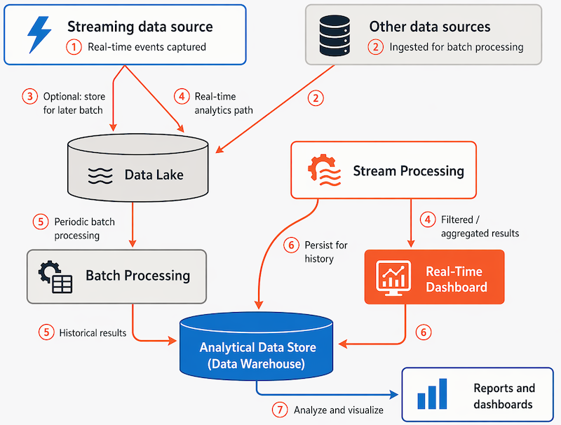</p>

1. Streaming data events are captured in real time.
2. Data from other sources is ingested into a data store (often a **data lake**) for batch processing.
3. If real time analytics is not needed, streaming data is written to the data store for later batch processing.
4. If real time analytics is needed, a stream processor filters or aggregates the data over time windows.
5. Non streaming data is batch processed and saved in an analytical store (often a **data warehouse**).
6. Stream processing results can also be saved to the analytical store.
7. Analytical and visualization tools present the real time and historical data.

> [!NOTE]
> Other patterns include the **delta** architecture and the **kappa** architecture. Kappa removes the separate batch layer and treats all data as a stream, replaying it when reprocessing is needed.

#### Explore common elements of stream processing architecture

<p align="center">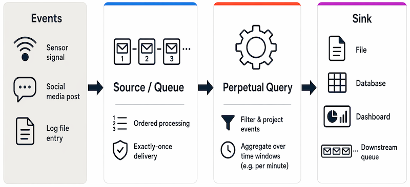</p>

1. **Event:** something generates data (a sensor signal, a social media post, a log entry).
2. **Source:** the data is captured in a streaming source, often a **queue** that keeps events in order and processes each one once.
3. **Perpetual query:** the data is processed continuously, often aggregated over time **windows** (for example, sensor readings per minute).
4. **Sink:** results are written to an output such as a file, table, dashboard, or another queue.

##### Real time analytics services

| Service | Description |
|:--|:--|
| **Microsoft Fabric Real Time Intelligence** | Integrated toolset in Fabric: **Eventstreams** (ingest and transform), **Eventhouse** (time series database queried with **KQL**), **Real Time Dashboards**, and **Activator** (automated actions). AI can generate KQL from questions. |
| **Spark Structured Streaming** | Open source library for streaming on Spark, available in Azure Databricks and Microsoft Fabric. |
| **Azure Stream Analytics** | PaaS service for **streaming jobs**: input, perpetual query, output. Good for standalone or hybrid scenarios outside Fabric. |

##### Sources for stream processing

| Source | Description |
|:--|:--|
| **Azure Event Hubs** | High volume event ingestion. Events in a partition are delivered in order, with at least once delivery. |
| **Azure IoT Hub** | Like Event Hubs, but optimized for IoT devices. |
| **Azure Data Lake Store Gen 2** | Mostly for batch, but can also be a streaming source. |
| **Apache Kafka** | Open source ingestion, often used with Spark. |

##### Sinks for stream processing

| Sink | Purpose |
|:--|:--|
| **Azure Event Hubs** | Queue processed data for more downstream processing |
| **Azure Data Lake Store Gen 2**, **OneLake**, **Azure Blob Storage** | Save results as files |
| **Azure SQL Database**, **Azure Databricks**, **Microsoft Fabric** | Save results in tables for querying |
| **Power BI** | Real time reports and dashboards |

#### Explore Microsoft Fabric Real Time Intelligence

A set of tools in Fabric that covers the full streaming pipeline: connect to sources, store and query data, build live dashboards, and trigger alerts, all in one workspace.

<p align="center">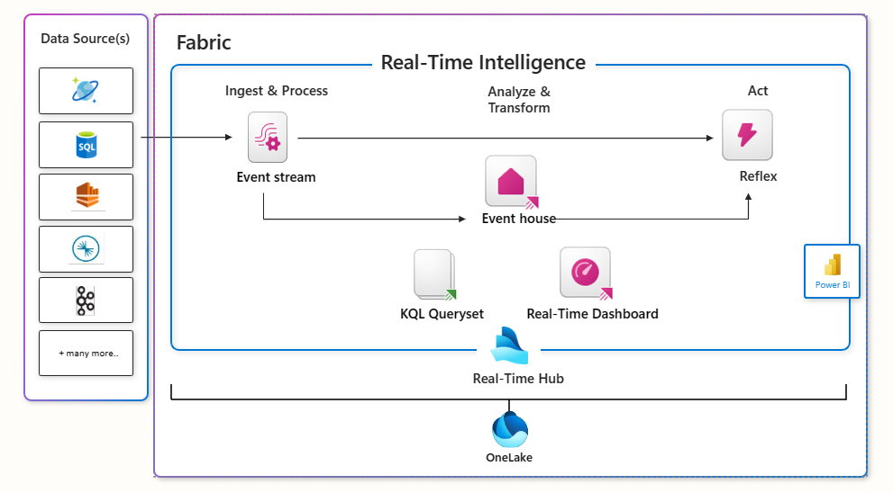</p>

- **Real time hub:** a central catalog to discover, add, explore, and share streaming data across the organization.
- **Exploring data:** choose a data stream, then use Real Time Intelligence tools to visualize patterns, anomalies, and forecasts.
- **Real Time Dashboards** are accessible through visual tools, natural language, and Copilot.
- **Activator alerts** turn insights into real time actions.

#### Explore Apache Spark structured streaming

**Apache Spark** processes very large data by splitting the work across a **cluster** of machines that run in parallel. It is available in **Microsoft Fabric** and **Azure Databricks**, supports Python, Scala, and Java, and handles both batch and streaming.

##### Spark Structured Streaming

It treats a live stream like a table that keeps growing as new data arrives.

1. Connect to a **streaming source** (Event Hubs, a folder of files, a network feed).
2. Read incoming data into a **dataframe** that keeps filling with new rows.
3. Run a **query** on the dataframe (for example, events per minute or a running average).
4. Write the results to an **output** (sink).

<p align="center">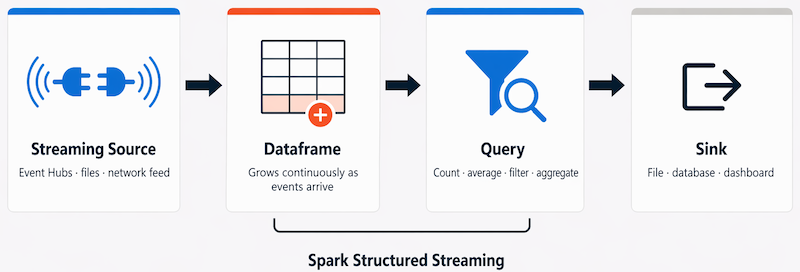</p>

> [!TIP]
> A good choice when you already use Spark and want to add real time streams.

##### Delta Lake

Makes data lake storage behave more like a database:

- **Reliability:** changes are tracked, so partial or failed writes do not corrupt data.
- **Schema enforcement:** data must match a defined structure.
- **Unified batch and streaming:** one Delta table can be a streaming sink and a batch source at the same time.

Delta Lake with Spark Structured Streaming gives you one consistent store for real time ingestion and historical analysis.

#### Key Takeaways

- **Batch processing** handles large groups of data with high latency. **Stream processing** handles each event as it arrives with low latency.
- The **lambda architecture** combines batch and stream processing.
- A streaming solution follows **event, source, perpetual query, sink**.
- Azure options include **Fabric Real Time Intelligence**, **Spark Structured Streaming**, and **Azure Stream Analytics**.
- **Delta Lake** lets one table serve both streaming and batch workloads.

<p align="right"><a href="#table-of-contents">⬆ Back to top</a></p>

---

### Module 9: Explore fundamentals of data visualization

#### Describe Power BI tools and workflow

**Microsoft Power BI** is a suite of tools and services, and a core workload of Microsoft Fabric, for building interactive visualizations.

<p align="center">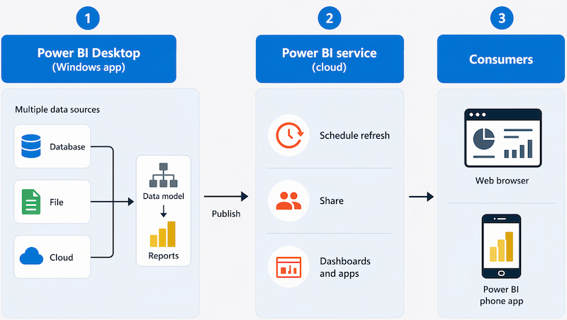</p>

| Tool | Purpose |
|:--|:--|
| **Power BI Desktop** | Windows app to import data, build data models, and create reports |
| **Power BI service** | Cloud service to publish, share, and interact with reports. Schedules data refreshes. Supports basic editing and **dashboards** and **apps**. |
| **Power BI phone app** | View reports, dashboards, and apps on mobile devices |

##### Power BI in Microsoft Fabric

- **Workspaces:** shared spaces where teams work on reports and semantic models in a browser.
- **Semantic models:** define measures, relationships, and hierarchies, and can be shared by many reports.
- **Direct Lake mode:** queries OneLake files directly with in memory speed, with no import or refresh cycle.
- **Web based report editing:** create and update reports without installing Power BI Desktop.

##### AI assistance in Power BI

**Copilot in Power BI** requires Fabric capacity (F2 or higher) or Power BI Premium (P1 or higher):

- Summarize a report in plain language
- Create report pages with suitable chart types
- Generate DAX measures from a description

Available **without** a Copilot license:

- **Smart narrative visual:** a text summary of the data that updates as the data changes

#### Describe core concepts of data modeling

A **semantic model** (analytical model) is made of related tables:

- **Measures:** the numeric values you analyze (revenue, quantity).
- **Dimensions:** the entities you aggregate by (product, customer, time).

##### Tables and schema

| Table type | Contents |
|:--|:--|
| **Dimension table** | Entities to group or filter by. Each row has a unique key plus attributes. Most models include a **Time** dimension. |
| **Fact table** | Numeric measures. Each row is an event, such as a sale. |

- **Star schema:** a fact table related to dimension tables.
- **Snowflake schema:** dimension tables related to more detail tables (for example, Category linked to Product).

<p align="center"></p>

Power BI stores loaded data in an in memory columnar store using the **VertiPaq** engine and calculates aggregations at query time.

##### Attribute hierarchies

**Hierarchies** let you **drill up** and **drill down** through levels of a dimension:

- **Product:** category, then product
- **Customer:** city, then customer
- **Time:** year, then month, then day

<p align="center"></p>

##### Analytical modeling in Microsoft Power BI

Use the **Model view** in Power BI Desktop to create relationships between fact and dimension tables, define hierarchies, and set data types and formats. For data in OneLake, use **Direct Lake** mode.

<p align="center"></p>

#### Describe considerations for data visualization

| Visualization | Best for | Preview |
|:--|:--|:-:|
| **Tables and text (cards)** | Showing many related values, or highlighting key figures |  |
| **Bar and column charts** | Comparing numeric values across categories |  |
| **Line charts** | Showing trends, often over time |  |
| **Pie charts** | Showing parts of a total |  |
| **Scatter plots** | Finding relationships or correlation between two measures |  |
| **Maps** | Comparing values across locations |  |

##### Interactive reports in Power BI

Visuals in a report are linked automatically. Selecting a value in one visual (for example, the city **Seattle**) filters and highlights the related visuals.

<p align="center"></p>

##### AI driven visualizations in Power BI

| Feature | What it does |
|:--|:--|
| **Smart narratives** | Written summaries of a visual that update as data changes |
| **Q&A visual** | Ask questions in plain English and get chart answers |
| **Key influencers** | Shows which factors most strongly drive a selected metric |
| **Decomposition tree** | Interactive drill down across dimensions to see what contributes to a value |

#### Key Takeaways

- The Power BI workflow: build in **Desktop**, publish to the **service**, and view on the web or **phone app**.
- **Semantic models** are built from **fact** and **dimension** tables in a **star** or **snowflake** schema.
- **Hierarchies** enable drill up and drill down.
- Choose visuals by purpose: compare (bar or column), trend (line), proportion (pie), correlation (scatter), location (map).
- Power BI adds AI through **Copilot**, **smart narratives**, **Q&A**, **key influencers**, and **decomposition trees**.

<p align="right"><a href="#table-of-contents">⬆ Back to top</a></p>

---

## References

- Microsoft Learn: Microsoft Azure Data Fundamentals learning path
- Images: © Microsoft, from Microsoft Learn training modules